# Runnel (RNL)

**Runnel** is an experimental, transport-independent encrypted tunnelling protocol and Rust implementation. It is designed around a small authenticated packet format and a shared session engine, with UDP as the primary carrier and TCP/SCTP adapters for environments where datagram transport is unavailable or unsuitable.

> [!WARNING]
> **Runnel is not a production-ready VPN and must not be used to protect sensitive or business-critical traffic.**
> The current implementation is an early development build. It does not yet provide a usable kernel TUN data path in its command-line applications, a complete key-update protocol, or the operational and security assurance expected of a v1.0 VPN. The `v1.0` milestone described below is a target, not a claim that this repository is already at that level.

[](https://www.rust-lang.org/)
[](LICENSE-MIT)
[](#release-status)

## Contents

- [Project goals](#project-goals)
- [Current implementation](#current-implementation)
- [Architecture](#architecture)
- [Protocol overview](#protocol-overview)
- [Security model and limitations](#security-model-and-limitations)
- [Requirements](#requirements)
- [Build and test](#build-and-test)
- [Run the current echo demonstration](#run-the-current-echo-demonstration)
- [Configuration reference](#configuration-reference)
- [Performance](#performance)
- [Roadmap to v1.0](#roadmap-to-v10)
- [Development](#development)
- [Contributing](#contributing)
- [License](#license)

## Project goals

Runnel aims to provide:

- **Transport independence:** keep session, framing, and cryptographic logic separate from the underlying carrier.
- **Authenticated encryption:** use a reviewed Noise handshake and a standard AEAD construction; do not invent cryptographic primitives.
- **Datagram-friendly delivery:** allow packet reordering while rejecting duplicate and stale packets.
- **Predictable resource use:** bound frames, reuse buffers, and avoid unbounded queues in production data paths.
- **Operational flexibility:** support UDP first, with TCP and optional SCTP carriers.
- **A Rust-first implementation:** expose reusable crates as well as client and server binaries.

The project is not intended to be wire-compatible with WireGuard, QUIC, OpenVPN, or any other VPN protocol.

## Current implementation

The repository currently contains the following components:

| Capability | Current state | Notes |
|---|---|---|
| Fixed RNL packet header | Implemented | 24-byte, big-endian header |
| Noise IK handshake | Implemented | `Noise_IKpsk0_25519_ChaChaPoly_BLAKE2s` |
| ChaCha20-Poly1305 data protection | Implemented | Directional keys derived from the handshake hash |
| Replay protection | Implemented | 4096-packet sliding window; authentication-before-commit hardening is in progress on the release branch |
| UDP transport | Implemented | Linux batched I/O plus portable fallback |
| TCP transport | Implemented | Length-prefixed stream framing |
| SCTP transport | Optional implementation | Linux-only feature; requires system SCTP support |
| Congestion control and priority scheduler | Implemented as a component | NewReno-style controller and weighted scheduling |
| MTU probing | Implemented as a component | Probe ladder and path challenge/response |
| Address migration | Implemented in server engine | Candidate address validation before migration |
| Multi-core UDP receive | Feature-gated | Linux `SO_REUSEPORT` workers |
| Active/standby path manager | Primitive implemented | Not full packet-level multipath distribution |
| Kernel TUN integration | **Not implemented in the CLI data path** | Current binaries are demonstration-oriented |
| Automatic traffic-key update | **Not implemented** | Rekey accounting exists; a complete interoperable update state machine is required |
| Production key provisioning and rotation | **Incomplete** | Do not treat the example configuration as a hardened deployment |
| Production observability and service operations | **Incomplete** | Metrics, health endpoints, privilege management, and lifecycle behavior need further work |

Features in a library crate do not necessarily mean that the command-line applications expose a complete, production-usable VPN feature.

## Architecture

The workspace is split into small crates:

```text
.
├── apps/
│   ├── rnl-client/          # rnl-client binary
│   └── rnl-server/          # rnl-server binary
└── crates/
    ├── rnl-core/            # Wire header, frames, sessions, MTU, framing, buffers
    ├── rnl-crypto/          # Noise handshake, key helpers, replay window
    ├── rnl-transport/       # Transport trait, UDP, TCP, optional SCTP
    ├── rnl-congestion/      # Congestion controller, priority scheduler, paths
    ├── rnl-tun/              # TunDevice abstraction and loopback device
    ├── rnl-config/          # Strict TOML configuration
    ├── rnl-observability/   # Observability primitives
    ├── rnl-server/          # Server engine and session management
    └── rnl-client/          # Client engine
```

### Data flow

```mermaid
flowchart LR
    A[IP packet source] --> B[TunDevice abstraction]
    B --> C[Client engine]
    C --> D[Session and packet framing]
    D --> E[Noise-derived AEAD]
    E --> F[Transport adapter]
    F -->|UDP / TCP / SCTP| G[Transport adapter]
    G --> H[AEAD authentication and replay check]
    H --> I[Server session engine]
    I --> J[TunDevice abstraction]
    J --> K[IP packet destination]
```



The `TunDevice` abstraction is the boundary between Runnel and a virtual network interface. The current `LoopbackDevice` is intended for tests and demonstrations; it is not a replacement for an operating-system TUN interface.

## Protocol overview

### Packet header

RNL uses a fixed 24-byte header. Multi-byte integers are encoded in network byte order (big-endian).

| Offset | Size | Field | Description |
|---:|---:|---|---|
| 0 | 2 | Magic | ASCII `RN` (`0x52 0x4e`) |
| 2 | 1 | Version | Currently `1` |
| 3 | 1 | Frame type | Frame discriminator |
| 4 | 2 | Flags | Reserved/defined by the protocol |
| 6 | 2 | Header length | Currently `24` |
| 8 | 8 | Session ID | Random non-zero session identifier |
| 16 | 8 | Packet number | Directional packet number |

For encrypted transport-mode frames, the header is authenticated as AEAD associated data. A 16-byte Poly1305 tag follows the encrypted payload.

### Frame types

The current code assigns these values:

| Value | Name |
|---:|---|
| `0x01` | `CLIENT_HELLO` |
| `0x02` | `SERVER_HELLO` |
| `0x03` | `HANDSHAKE_FINISH` |
| `0x04` | `AUTHENTICATION` |
| `0x05` | `KEEPALIVE` |
| `0x06` | `PATH_CHALLENGE` |
| `0x07` | `PATH_RESPONSE` |
| `0x08` | `KEY_UPDATE` |
| `0x09` | `ACK` |
| `0x0a` | `CONFIGURATION` |
| `0x0b` | `DISCONNECT` |
| `0x20` | `DATA` |
| `0x21` | `RELIABLE_CONTROL` |

Assignment of a frame type does not imply that its complete protocol state machine is implemented. In particular, `KEY_UPDATE` is reserved/assigned but automatic key updates are not complete.

### Cryptographic suite

The fixed handshake suite is:

```text
Noise_IKpsk0_25519_ChaChaPoly_BLAKE2s
```

The implementation uses the `snow` Noise framework. The current data plane uses ChaCha20-Poly1305 with separate client-to-server and server-to-client traffic keys derived from the completed Noise handshake hash. The 96-bit nonce is constructed from a zero prefix and the 64-bit packet number.

There is no runtime cipher negotiation. This avoids introducing a downgrade negotiation surface in the current fixed-suite design.

### Replay handling

The receive path uses a 4096-packet sliding window to allow legitimate UDP reordering while rejecting duplicates and packets outside the accepted window. A packet number must not advance replay state until its AEAD tag has been verified; otherwise an unauthenticated sender could poison the window with a forged high packet number.

## Security model and limitations

Runnel is security-sensitive networking software. The following points are important:

1. **Experimental status:** there has not been a published independent cryptographic or protocol audit.
2. **No production TUN path:** the current command-line applications are not a complete general-purpose VPN.
3. **No complete key update:** traffic keys must not be used indefinitely. A production release requires a specified, tested key-update protocol, epoch handling, loss/reordering behavior, and nonce-safety guarantees.
4. **PSK configuration:** the current implementation accepts an optional PSK and historically falls back to a fixed all-zero value when omitted. A fixed public value is not a secret and must never be described as an additional authentication factor. Production configuration should require explicit secure provisioning and must not silently imply PSK protection.
5. **Transport trade-offs:** TCP encapsulation can suffer from head-of-line blocking. SCTP availability depends on the host kernel and system libraries. Carrier failover is not equivalent to seamless multipath.
6. **Network policy:** routing, DNS, IPv4/IPv6 forwarding, firewall rules, DNS leak prevention, and kill-switch behavior must be explicitly implemented and tested before general VPN deployment.
7. **Resource-exhaustion resistance:** handshake admission, per-peer limits, bounded queues, timeouts, and rate limits need production validation.
8. **Secrets:** private keys and PSKs must be provisioned through an appropriate secret-management mechanism. Do not commit real credentials to source control, logs, issue reports, or example files.

Please report suspected vulnerabilities privately to the maintainers rather than publishing exploit details in an issue.

## Requirements

For the core workspace:

- Rust toolchain with Cargo (edition 2021).
- A supported host platform for the selected crates and features.

For Linux-specific functionality:

- Linux kernel and toolchain support for the relevant socket APIs.
- SCTP feature: kernel SCTP support and the system development/runtime dependencies required by the host.
- A future TUN-enabled deployment will require permission to create/configure a TUN interface (typically `CAP_NET_ADMIN` or equivalent privileges).

## Build and test

Clone the repository and enter its directory:

```bash
git clone https://github.com/rnetis/runnel.git
cd runnel
```

Build all workspace members:

```bash
cargo build --workspace
cargo build --workspace --release
```

Run the test suite:

```bash
cargo test --workspace
```

Check formatting and linting:

```bash
cargo fmt --all -- --check
cargo clippy --workspace --all-targets -- -D warnings
```

Run benchmarks where supported:

```bash
cargo bench --workspace
```

Optional Linux SCTP build (requires the host's SCTP development/runtime support):

```bash
cargo test -p rnl-transport --features sctp
```

The commands above describe the expected developer checks; they are not a claim that all targets or optional features have been verified on every platform. Record the toolchain, OS, feature set, and test output when reporting failures.

## Run the current echo demonstration

The current binaries provide an encrypted echo demonstration, not a production tunnel. The example below is a starting point for local development only.

### 1. Create a server configuration

Save as `server.toml`:

```toml
[server]
listen = "127.0.0.1"
port = 45820
interface = "rnl0"
mtu = 1380

[security]
protocol_version = 1
cipher = "chacha20-poly1305"
handshake = "noise-ik"
replay_window = 4096

[transports]
udp = true
tcp = false
sctp = false
preferred = "udp"
fallback = false

[session]
keepalive_seconds = 25
rekey_seconds = 600
rekey_bytes = 1073741824

[[clients]]
id = "local-client"
public_key = "<32-byte-client-X25519-public-key-as-64-hex-characters>"
enabled = true
allowed_ips = []
```

Replace the placeholder with the actual client static public key. The server configuration parser validates the key length and rejects unknown fields.

### 2. Create a client configuration

Save as `client.toml`:

```toml
[client]
server = "127.0.0.1:45820"
private_key = "<32-byte-client-X25519-private-key-as-64-hex-characters>"
interface = "rnl0"
mtu = 1380

[security]
protocol_version = 1
cipher = "chacha20-poly1305"
handshake = "noise-ik"
replay_window = 4096
```

Use a keypair whose public key is present in the server's `clients` list. Protect the private key file with restrictive filesystem permissions. Do not use placeholder values as real keys.

### 3. Start the server echo mode

```bash
RUST_LOG=info cargo run --release -p rnl-server-bin -- --config server.toml --echo
```

### 4. Run the client echo demonstration

In another terminal:

```bash
RUST_LOG=info cargo run --release -p rnl-client-bin -- --config client.toml --echo-demo
```

The client demonstration sends synthetic packets and verifies the encrypted echo response. It does not route normal host traffic through a TUN interface.

> [!NOTE]
> The current CLI does not yet provide a supported key-generation subcommand. Generate X25519 keys with a suitable trusted tool or test helper, and verify that the configured public and private keys form a pair. A dedicated key-management command is part of the v1.0 release work.

## Configuration reference

The configuration parser uses strict deserialization and rejects unknown fields.

### Server

| Key | Type | Meaning |
|---|---|---|
| `server.listen` | string | Bind address |
| `server.port` | integer | UDP listen port |
| `server.interface` | string | Intended virtual interface name |
| `server.mtu` | integer | Configured MTU |
| `server.workers` | integer or omitted | Optional UDP worker count |

### Client

| Key | Type | Meaning |
|---|---|---|
| `client.server` | string | Server endpoint in `host:port` form |
| `client.private_key` | hex string | Client static X25519 private key |
| `client.interface` | string | Intended virtual interface name |
| `client.mtu` | integer | Configured MTU |
| `client.fallback_server` | string or omitted | Explicit TCP fallback endpoint |

### Security

| Key | Type | Meaning |
|---|---|---|
| `security.protocol_version` | integer | Must be `1` |
| `security.cipher` | string | Must be `chacha20-poly1305` |
| `security.handshake` | string | Must be `noise-ik` |
| `security.replay_window` | integer | Must be `4096` |
| `security.psk` | 64-character hex string or omitted | Optional 32-byte PSK; omission currently selects a public all-zero value |

### Transports

The server transport section includes `udp`, `tcp`, `sctp`, `preferred`, `fallback`, `tcp_port`, and `tcp_advertise`. TCP fallback requires a reachable endpoint and matching server/client configuration. SCTP is optional and Linux-specific.

### Session

The session section includes `keepalive_seconds`, `rekey_seconds`, and `rekey_bytes`. These are configuration/accounting parameters; they do not mean that a complete automatic key-update protocol is currently available.

## Performance

The repository includes Criterion benchmarks for packet encoding, session cryptography, replay checks, and scheduling. Earlier local measurements are historical development baselines, not independently reproducible performance guarantees.

To produce meaningful results, record:

- CPU model, core count, and frequency policy.
- OS, kernel, Rust version, and build flags.
- Carrier and network topology.
- Packet size distribution, concurrency, and test duration.
- Throughput, RTT/latency percentiles, packet loss, CPU usage, and memory.
- Whether measurements include encryption, transport, routing, and TUN I/O.

Do not compare a loopback microbenchmark with end-to-end VPN throughput.

## Roadmap to v1.0

A v1.0 release should not be cut until the following gates are met:

### P0 — Protocol and cryptographic safety

- [ ] Publish a normative wire-format and state-machine specification.
- [ ] Complete replay-window authentication ordering and adversarial regression tests.
- [ ] Specify and implement authenticated key updates, epochs, packet-number reset rules, and old-key retirement.
- [ ] Require explicit secure PSK provisioning or remove the misleading all-zero fallback from production modes.
- [ ] Add strict bounds and validation for all frame types, lengths, counters, and configuration.
- [ ] Add fuzzing for packet parsing, stream framing, configuration parsing, and handshake inputs.
- [ ] Add property tests for replay-window shifts, packet reordering, and nonce uniqueness.

### P0 — Usable VPN data path

- [ ] Implement Linux kernel TUN creation, configuration, and packet I/O.
- [ ] Wire client and server engines to real TUN devices.
- [ ] Implement route management, forwarding, and IPv4/IPv6 behavior.
- [ ] Document firewall, DNS, leak-prevention, and shutdown/cleanup behavior.
- [ ] Test reconnect, interface failure, carrier failover, and process termination.

### P1 — Reliability and operations

- [ ] Bound all queues and per-peer/session resources.
- [ ] Add handshake and idle-session timeouts, admission controls, and rate limiting.
- [ ] Add graceful shutdown and deterministic resource cleanup.
- [ ] Add structured metrics, health/readiness checks, and useful operational logs.
- [ ] Add config validation commands and secure key-generation/provisioning workflows.
- [ ] Test multi-client operation and concurrent session lifecycle.

### P1 — Compatibility and performance

- [ ] Define supported OS, architecture, and Rust toolchain matrix.
- [ ] Test UDP/TCP/SCTP behavior under loss, reordering, congestion, and path changes.
- [ ] Complete or clearly scope multipath; do not advertise active/standby primitives as full multipath.
- [ ] Establish reproducible end-to-end throughput and latency benchmarks.
- [ ] Verify memory bounds and CPU behavior under hostile traffic.

### P1 — Release quality

- [ ] CI for formatting, linting, tests, feature builds, and supported targets.
- [ ] Security policy and vulnerability disclosure process.
- [ ] Changelog, versioning policy, signed release artifacts, and checksums.
- [ ] Installation and upgrade/uninstall instructions.
- [ ] Independent protocol/cryptographic review before stable release.

## Development

Useful workspace commands:

```bash
# Run all tests
cargo test --workspace

# Test one crate
cargo test -p rnl-core

# Build the server binary
cargo build -p rnl-server-bin --release

# Build the client binary
cargo build -p rnl-client-bin --release

# Check all targets
cargo check --workspace --all-targets

# Run a specific benchmark
cargo bench -p rnl-core
```

Keep protocol changes small and reviewable. Changes to the wire format, handshake, nonce construction, key derivation, replay behavior, or session state machine require dedicated tests and a protocol-specification update.

## Contributing

Contributions are welcome, especially around protocol review, test coverage, Linux networking, TUN integration, observability, and documentation.

Before opening a pull request:

1. Explain the problem and intended behavior.
2. Include tests for bug fixes and protocol edge cases.
3. Run formatting, Clippy, and the relevant test suites.
4. Document user-visible configuration or wire-format changes.
5. Never include real private keys, PSKs, production endpoints, or customer data.

For security-sensitive changes, describe the threat model and failure behavior in the pull request.

## License

Unless otherwise noted, Runnel is dual-licensed under either:

- [MIT](LICENSE-MIT)
- [Apache License, Version 2.0](LICENSE-APACHE)

You may choose either license.
